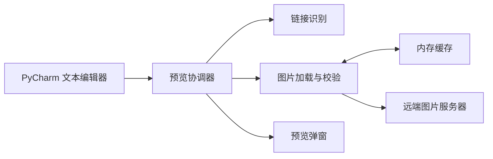

# 图片链接预览插件技术规范与总体架构

## 1. 文档定位与目标环境

本文定义首版插件的行为、质量要求与模块边界，作为后续设计、实现和验收依据。目标环境固定为 **Apple Silicon、macOS 15.6、PyCharm Professional 2024.1.7（`PY-241.19416.19`）**。插件只在 PyCharm 的文本编辑器内提供图片链接预览，不修改用户文件。[PyCharm 插件开发文档](https://plugins.jetbrains.com/docs/intellij/pycharm.html) · [版本与 Java 对照](https://plugins.jetbrains.com/docs/intellij/build-number-ranges.html)

## 2. 功能规范

| 编号 | 首版要求 | 验收依据 |
| --- | --- | --- |
| F1 | 仅在当前打开的文本编辑器中识别鼠标所在行、鼠标所指位置的完整 `http://` 或 `https://` 链接。 | Python 字符串、Markdown 和普通文本中的单行链接可识别；同一行多个链接互不混淆。 |
| F2 | 鼠标在链接上停留约 400 毫秒后才发起预览；打开文件、滚动或普通输入不主动下载图片。 | 未悬停时无网络请求；快速移过链接不弹窗。 |
| F3 | 仅预览成功返回且实际可解码的 PNG、JPEG、GIF；GIF 显示静态首帧。不能只凭 URL 后缀判断类型。 | 无后缀图片可预览；网页、损坏数据或不支持的格式不显示图片。 |
| F4 | 在链接附近显示按比例缩放的单个预览弹窗；鼠标离开、切换文件或编辑链接后，过期预览必须消失。 | 弹窗不遮挡输入；迟到的网络结果不会显示到其他文件或位置。 |
| F5 | 网络失败、超时、过大或离线时不阻断编辑操作。 | 编辑器仍可流畅输入；失败后再次悬停可以重试。 |

首版范围不含本地路径、相对路径、需要登录的图片、跨行拼接 URL、SVG/WebP、下载保存、工具窗口或设置页面。若后续增加格式或来源，应先更新本规范和验收场景。

## 3. 非功能要求与约束

- **性能**：仅分析悬停位置所在行；网络和解码不得占用界面线程。每次交互最多显示一个弹窗，重复悬停可复用已有预览。目标是鼠标移动和文字输入无可感知卡顿。[JetBrains 线程模型](https://plugins.jetbrains.com/docs/intellij/threading-model.html)
- **资源**：单次请求超时上限暂定 5 秒，响应体上限 5 MiB，图片像素尺寸上限 4096 × 4096；预览框不超过约 480 × 320 像素。仅保留少量内存缓存，项目关闭或插件卸载后释放。
- **网络与隐私**：只访问用户明确悬停的 HTTP(S) 地址；限制重定向，不携带 IDE 登录凭据或 Cookie，不持久化图片与 URL。拒绝非图片响应、超限内容及无法解码的数据。
- **兼容性**：以 PyCharm 2024.1.7 和 Java 17 为编译与验证基线；未经验证，不宣称兼容其他 PyCharm 构建号。首版不依赖 Python PSI、外部 Python 服务或 macOS 原生库。

## 4. 总体架构

| 模块 | 输入与职责 | 输出 |
| --- | --- | --- |
| 编辑器适配 | 提供鼠标位置、当前文档与生命周期事件。 | 当前悬停上下文。 |
| 链接识别 | 只解析鼠标所在行，去除外围标点并判断鼠标是否落在 URL 上。 | URL 与文本位置，或“无链接”。 |
| 预览协调 | 管理悬停延时、当前请求、过期结果和单个弹窗；在编辑器状态变化时取消任务。 | 预览请求或关闭指令。 |
| 图片加载与缓存 | 限时获取、限制资源、校验并解码图片；复用短期结果。 | 缩放后的图片或失败结果。 |
| 预览弹窗 | 只负责显示图片或简短状态，不读取文件、不发网络请求。 | 编辑器内的临时界面。 |

**数据流**：编辑器事件 → 定位单行 URL → 延时确认仍在同一链接 → 查询缓存或后台加载 → 校验图片 → 在界面线程显示。每个请求关联发起时的编辑器、文档版本和 URL；其中任一条件改变，结果立即作废。模块之间只传递必要的 URL、位置和图片数据，避免持有完整项目内容。

## 5. 验收范围

验收覆盖正常图片、无扩展名图片、同一行多链接、括号或引号包裹的链接、非图片响应、损坏图片、超限图片、超时和离线场景。还需在 Apple Silicon 的 macOS 15.6 与 PyCharm Professional 2024.1.7 上验证快速移动鼠标、编辑链接、切换标签页和关闭项目时不会出现错位弹窗、资源泄漏或界面卡顿。

本文记录首版规范与架构；实现状态及实际运行命令见项目根目录 `README.md`。
